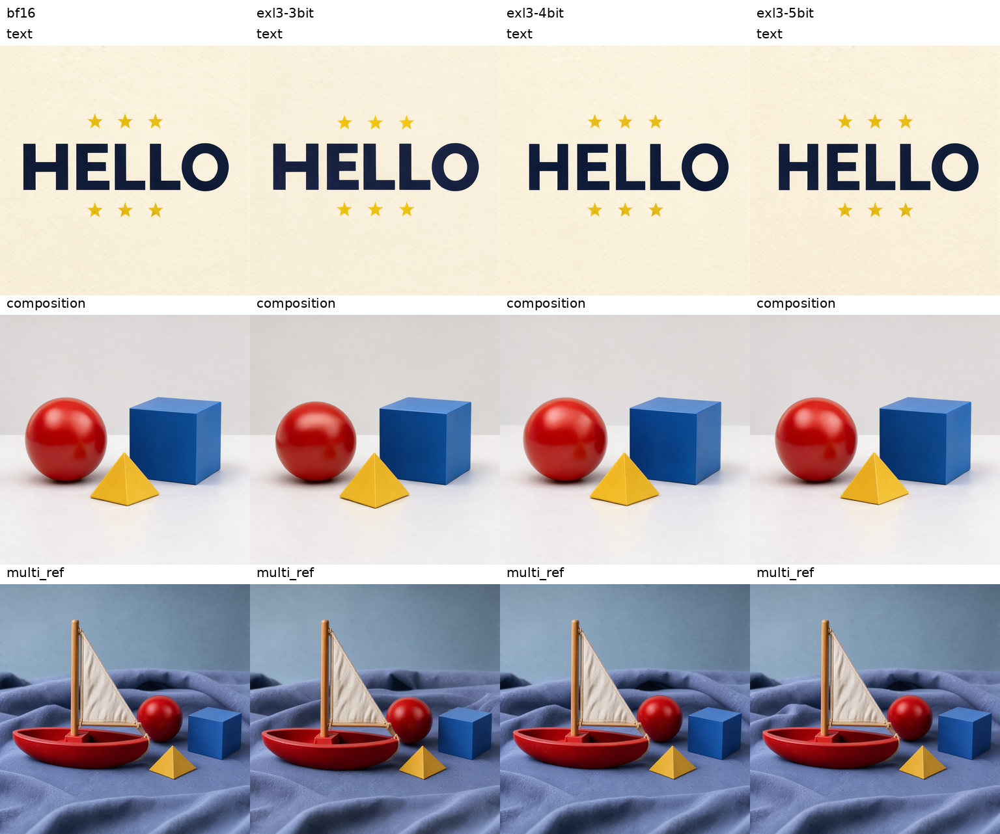

# FLUX.3 Image Klein EXL3

対象は[black-forest-labs/flux-3-image-klein](https://huggingface.co/black-forest-labs/flux-3-image-klein)の
distilledモデル。[固定revision](../rocm_tools/flux3_sources.json)を使用する。
16ステップのflow-map samplingで、現在時刻に加えて移動先の`target_timestep`を渡す。
text encoderはQwen3-VL-4Bの8 hidden layersを結合し、80トークン単位で右paddingする。
DiTとtext encoderはBF16、VAEはFP32。出力はRGB。

2026-10-19、通常のBF16モデルと同じパイプラインでEXL3推論を実装・実機確認した。
258個のblock Linearを3・4・5bit化し、同じcheckpointをR9700とV620で読み込める。
[完了条件と監査](flux3_exl3_goal.md)、[比較データ](../benchmarks/2026-10-19/flux3/comparison.json)、
[32件の生report・全重みchecksum監査](../benchmarks/2026-10-19/flux3/reports/index.json)を参照。

## 実測結果

R9700単体、1024×1024、batch 1、16ステップ、固定composition入力。
DiTはGPU常駐、text encoderだけをモジュール単位でCPU offload。
warmup 1回＋計測3回の中央値で、初期ロード・PUP・PNG保存を除き、
text encoding・denoising・FP32 VAEを含む。復元workspaceは256 MiB。

| 精度 | 実効DiT bpw | safetensors GB | denoising秒 | 生成全体秒 | ピークallocated GiB | NMSE ↓ |
|---|---:|---:|---:|---:|---:|---:|
| BF16 | — | — | 10.028 | 11.622 | 13.744 | — |
| EXL3 3bit | 3.6476 | 2.530 | 10.753 | 12.348 | 5.775 | 0.0065190011 |
| EXL3 4bit | 4.5983 | 3.189 | 10.751 | 12.345 | 6.444 | 0.0016975493 |
| EXL3 5bit | 5.5491 | 3.849 | 10.784 | 12.383 | 7.012 | 0.000467956625 |

4bitのdenoising増加は約7.2%、生成全体は約6.2%。ピークallocatedは約53.1%減。
allocatedはPyTorchの割り当て量で、GPU全体の使用量とは区別する。
実効bpwは高精度保持層・scalesを含む。保存容量はDiTのsafetensorsのみで、
text encoder・VAE・PUPは含まない。3・4・5bitはLinearのbit数。

NMSEはtext・composition・multi_ref各1 seed、計3ケースの全target要素・全16ステップの
総和比。BF16自己比較は **0**。bit数間で全ステップのlatent・BF16予測とconditioningの
SHA256が一致した。通常benchmarkの各精度の計測3回は画素hashも一致した。

## 画像と対応範囲

R9700のBF16と4bitでは、写真1024px、HELLOの文字、3物体の構図、船体色の単一参照編集、
2枚参照、写真2048pxの6ケースを完走・目視確認した。
3bit・5bitはtext・composition・multi_refの3ケース、いずれも1024pxで確認した。
全件の最終latentとVAE出力はfinite。テキストのみでは228層、画像参照ありでは258層の
EXL3 Linearが全ステップで実行された。保持した高精度stateと校正manifestは全bitで一致した。

3bitでもHELLO、星の数、球・立方体・角錐、船と白い帆と青い布は維持された。
反射、位置、形状、布の折り目等には差がある。これは固定ケースでの初期確認であり、
すべての入力での画質やBF16との画素一致を保証するものではない。
[4bit目視記録](../benchmarks/2026-10-19/flux3/4bit-visual-review.json)、
[3・5bit目視記録](../benchmarks/2026-10-19/flux3/multibit-visual-review.json)。



V620単体でも3・4・5bitの1024pxテキスト生成、4bitの単一参照編集・2枚参照、
公式PUPからEXL3生成までを確認した。4bitの1回の動作診断は、構図125.64秒・6.40 GiB、
単一参照315.59秒・6.41 GiB、2枚参照461.95秒・7.68 GiBのピークallocatedだった。
これらはwarmupやGPU個体を揃えた速度比較ではない。
V620で2048pxと3・5bitの画像参照、複数GPUの画像推論は今回の確認範囲に含めない。
[初期実機記録](../benchmarks/2026-10-19/flux3-initial/)を参照。

公式PUPはV620でテキストと参照画像、R9700で参照画像からの一連の生成を確認した。
R9700のPUP付き編集では、展開98.64秒、展開後の画像生成41.92秒、PUPのピークallocated
18.11 GiBだった。単発のcold診断値で、上表の速度にはPUPを含めない。
[caption・元要求・実行記録](../benchmarks/2026-10-19/flux3/pup-r9700-full-edit.json.gz)、
[PUP画像確認](../benchmarks/2026-10-19/flux3/pup-validation.json)。

## 環境と取得

ROCm版PyTorchと、このGPU向けのネイティブ拡張を先に用意する。
今回の実行環境はQwen Imageと共通で、Diffusersはcommit
`b800f828f3951c4d206e154411bcbfa693cd322e`、Transformers 5.17.0。
R9700は`PYTORCH_ROCM_ARCH=gfx1201`、V620は`gfx1030`を指定して拡張をビルドする。
今回の検証では既存の拡張を再利用し、nativeコードは変更していない。
その拡張のビルド元commitは不明のため、クリーンビルドの再現確認とは区別する。
[環境と拡張SHA256（R9700）](../benchmarks/2026-10-19/flux3/r9700-environment.json)、
[V620](../benchmarks/2026-10-19/flux3/v620-environment.json)、
[R9700テスト5件](../benchmarks/2026-10-19/flux3/r9700-tests.txt)、
[V620テスト3件](../benchmarks/2026-10-19/flux3/v620-tests.txt)。

```bash
EXL3_BACKEND=rocm PYTORCH_ROCM_ARCH=gfx1201 MAX_JOBS=8 \
  python -m pip install --no-build-isolation '.[diffusion]'
python -c 'import exllamav3_ext'

python rocm_tools/flux3.py download --output MODEL
python rocm_tools/flux3.py download --component upsampler --output PUP
```

`MODEL`と`PUP`は実際の保存先に置き換える。モデルのHubアクセス権限は事前に必要。
ダウンロードは固定revisionを使い、完了時に`exl3_source.json`を保存する。
EXL3生成だけを行う環境では`download --components-only`で元のdense DiTを省略できる。
校正・BF16基準・NMSEにはdense DiTが必要。

モデルの利用条件は取得した`LICENSE.md`・`NOTICE.md`と上流のモデルカードに従う。
エンジンのMITライセンスを重みに適用しない。

## 生成とプロンプト展開

短い要求は公式PUPで展開する。CLIはPUPをGPUから解放してからDiTを読み込み、
18.8 GBのPUPと画像モデルを同時にGPU常駐させない。

```bash
python rocm_tools/flux3.py generate --model MODEL --upsampler PUP \
  --prompt 'A red sphere on the left and a blue cube on the right.' \
  --seed 1703 --width 1024 --height 1024 --output OUTPUT
```

外部LLMで展開済みの詳細なscene captionは`--caption '...'`または
`--caption-file caption.txt`で渡す。短い要求を未展開のまま渡す用途には使わない。
公式PUPを単独で実行し、展開結果を保存することもできる。

```bash
python rocm_tools/flux3.py upsample --model PUP \
  --prompt 'A red sphere on the left and a blue cube on the right.' --output CAPTION
python rocm_tools/flux3.py generate --model MODEL \
  --caption-file CAPTION/caption.txt --output OUTPUT
```

画像編集・複数参照は`--images reference.png`または複数パスを指定する。
PUPと生成には同じ参照画像を渡す。参照画像は公式Diffusersの前処理を使い、
16px単位のcropを行う。`--boxes boxes.json`はPUPへのlayout指定で、
上流の0～1座標形式を使う。展開済みcaptionにはそのままbox tableを含められる。

V620（gfx10）では、PUPが使用するQwen3.5のFLA BF16カーネルでLLVMの未対応命令が
発生したため、該当する4関数をTransformersのPyTorch reference実装へ切り替える。
インストール先のTransformersや他のLLMサーバーのコードは変更しない。

V620のDiT Attentionは、queryを既定1024行ずつ計算して一時領域を抑える。
各queryはすべてのkeyへattendし、近似的なwindow制限は行わない。
R9700はnative SDPAを使用する。NMSEではteacherとcandidateに同じ設定を適用する。
単独の`generate --attention-query-chunk 0`でnativeへ、正の値で明示的なquery分割へ
切り替えられる。通常経路と分割経路の出力比較テストも行っている。

## 校正・変換・EXL3生成

[固定ケース](../rocm_tools/flux3_cases.json)は校正と評価を分けている。
全方式で同じcaption、seed、BF16参照画像を使用する。

```bash
python rocm_tools/flux3_suite.py calibrate --model MODEL --root RUN
python rocm_tools/flux3_suite.py convert --model MODEL --root RUN --bits 3 4 5
python rocm_tools/flux3_suite.py evaluate --model MODEL --root RUN \
  --precision exl3 --bits 4
```

対象はimage・image_cond・textのper-mode blocksとjoint single blocksのLinear。
公式モデルは計258層あり、テキストだけの入力では参照画像用30層が呼ばれない。
部分的な校正を統合し、全対象層に実際の入力が揃った場合だけ変換する。
block外の入力投影・時刻埋め込み・modulation・出力投影・normは高精度で保持する。
途中の変換は同一source・bit数・校正manifestでのみ再開できる。

`quantization.json`、transformer config、層ごとのEXL3 safetensorsからなる
このエンジン用のDiT checkpointを保存する。
単独のEXL3生成は`generate`へ`--exl3 RUN/exl3-4bit`を追加する。
重みは列方向に復元して入力と同じBF16/FP16で行列演算する。
復元用workspaceは既定256 MiBで、dense DiT全体をGPUへ展開しない。
EXL3の全対象層について、参照画像の有無に応じた実行回数を検査する。

## BF16比較とNMSE

```bash
python rocm_tools/flux3_suite.py evaluate --model MODEL --root RUN --precision bf16
python rocm_tools/flux3_suite.py evaluate --model MODEL --root RUN \
  --precision exl3 --bits 3 5 --cases text composition multi_ref
python rocm_tools/flux3_suite.py nmse --model MODEL --root RUN --bits 3 4 5
python rocm_tools/flux3_suite.py nmse-self --model MODEL --root RUN
python rocm_tools/flux3_suite.py benchmark --model MODEL --root RUN --precision bf16
python rocm_tools/flux3_suite.py benchmark --model MODEL --root RUN --precision exl3 --bits 3 4 5
python rocm_tools/flux3_compare.py --root RUN --output RUN/comparison --images
```

NMSEはBF16の軌道上の同じlatent・時刻・移動先時刻・text/reference条件で候補を呼び、
`sum((candidate - BF16)^2) / sum(BF16^2)`を求める。出力はtarget画像トークンのみ。
差分・二乗はFP32、集計はFP64。候補の出力はschedulerに渡さない。
各ステップのlatentとBF16予測、conditioning tensorのSHA256も記録する。
比較ツールはbit数をまたいでこれらが一致することを検証してから集計する。
既定はtext・composition・multi_refの3ケースで、全要素・全ステップの総和比を報告する。
知覚品質のスコアではないので、生成画像の確認も併用する。

benchmarkはcompositionのwarmup 1回＋3回計測。初期ロード、PUP、PNG保存を除き、
text encoding・参照画像のVAE encoding・denoising・VAE decodeを含む。
`--cached`はtext encodingだけを別計測にするため、同条件でのみ比較する。
校正・NMSEの時間は通常の生成速度と区別する。
集計は`RUN/results.json`、画像品質の出力は`RUN/quality/精度/ケース/`、
速度計測は`RUN/benchmark/精度/ケース/`へ保存する。checkpoint本体の
`RUN/exl3-4bit`等とは別のディレクトリで扱う。
各画像と生データはケース別の`report.json`に保存する。

## 今回のローカル配置

大きなデータは`~/datapool/`に保存した。

- BF16コンポーネント: `~/datapool/ai_models/safetensors/FLUX.3-Image-Klein`
- 公式PUP: `~/datapool/ai_models/safetensors/FLUX.3-Image-Klein-PUP`
- EXL3: `~/datapool/rocm-exl3-rdna2/flux3/r9700/exl3-{3,4,5}bit`
- 全実測・元画像: `~/datapool/rocm-exl3-rdna2/flux3/`

既存コンテナでは`/models/safetensors`と`/work/flux3`へ対応する。
R9700は`PYTHONPATH=/work/qwen-image21/python:/work/lib-r9700-opt:/src`、
V620は`/work/qwen-image21/python:/work/lib:/src`を使用した。
前者のパス名にQwenが残っているのは、共用した固定Diffusersのローカル配置による。

V620の既存LLMサーバーと検証用コンテナは停止済み。

## 公開モデル

3・4・5bitは[jyohukuchan/FLUX.3-Image-Klein-EXL3](https://huggingface.co/jyohukuchan/FLUX.3-Image-Klein-EXL3)
で公開。各bitフォルダを`generate --exl3`に指定する。
FLUX Kommunity License v1.0が適用され、MITライセンスの重みではない。
[ライセンス確認と公開手順](flux3_hf/publication.md)を参照。
