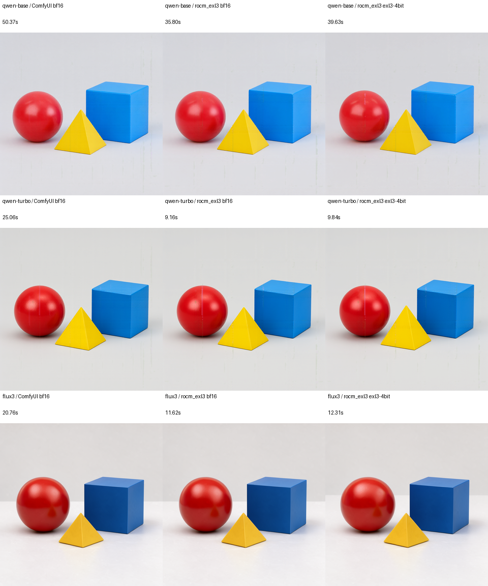

# R9700でのComfyUI BF16とrocm_exl3 BF16 / EXL3比較

2026-10-19、Radeon AI PRO R9700単体で実測した。
この設定では生成全体はrocm_exl3が短く、DiTのdenoisingはComfyUI BF16が短かった。
生成全体の差にはVAE実装とモデル退避方針が大きく影響する。
rocm_exl3のBF16経路は固定Diffusersの実装で、ComfyUIは独立したnative実装を使った。

## 実測値

すべて1024×1024、batch 1、CFG 1、seed 1703の同じ3物体の構図。
通常版40ステップ、Turboは保存済みsigma列の8ステップ、FLUX.3はshift 6.93の16ステップ。
各条件warmup 1回＋計測3回の中央値。**初期ロード・最初のwarmup・PNG保存・FLUX PUPを除く**。
毎回text encodingを行い、prompt/生成結果のノードキャッシュは使用しない。

生成全体はtext encoding、denoising、VAE、画像への後処理を含む秒数。

| モデル | ComfyUI BF16 | rocm_exl3 BF16 | rocm_exl3 EXL3 4bit |
|---|---:|---:|---:|
| Qwen-Image-2.1 | 50.373 | 35.797 | 39.626 |
| Qwen-Image-2.1-Turbo | 25.062 | 9.156 | 9.835 |
| FLUX.3 Image Klein | 20.763 | 11.622 | 12.309 |

denoisingは最初のDiT実行開始から最後の実行終了付近までのGPU event区間。
text encoding・VAE・最初のモデル転送を含まない。
Qwenの既存CLIは最後のscheduler callbackまで測るため、厳密な境界はわずかに異なる。
同じforward区間の総和も[比較JSON](../benchmarks/2026-10-19/image-engine-compare/comparison.json)へ記録した。

| モデル | ComfyUI BF16 | rocm_exl3 BF16 | rocm_exl3 EXL3 4bit |
|---|---:|---:|---:|
| Qwen-Image-2.1 | 31.635 | 33.397 | 37.016 |
| Qwen-Image-2.1-Turbo | 6.357 | 6.700 | 7.382 |
| FLUX.3 Image Klein | 8.143 | 10.014 | 10.710 |

denoisingの中央値はComfyUI BF16がrocm_exl3 BF16より約5～19%短い。
EXL3 4bitの追加時間はrocm_exl3 BF16比で通常版10.8%、Turbo 10.2%、FLUX.3 7.0%。
ComfyUI BF16に対しては、それぞれ約17%、16%、32%長い。

PyTorchのピークallocatedメモリ（GiB）の中央値。GPU全体の使用量とは異なる。

| モデル | ComfyUI BF16 | rocm_exl3 BF16 | rocm_exl3 EXL3 4bit |
|---|---:|---:|---:|
| Qwen-Image-2.1 | 30.257 | 15.162 | 5.417 |
| Qwen-Image-2.1-Turbo | 30.257 | 15.162 | 5.417 |
| FLUX.3 Image Klein | 19.386 | 13.744 | 6.444 |

rocm_exl3内の4bit化によるallocated削減はQwen約64%、FLUX.3約53%。
ComfyUIとのメモリ差には、BF16 text encoderのGPU常駐・退避方針の違いも含まれる。

## 生成全体とDiTの順位が異なる理由

ComfyUIのQwenではVAE＋後処理が約18秒を占めた。
このheadless構成では通常decodeと既定の大きなタイルfallbackがOOMになったため、
rocm_exl3と同じ256pxタイル・64px重なりを明示した。
ComfyUIの[`decode_tiled_`](https://github.com/Comfy-Org/ComfyUI/blob/8f04fd6ecf4a548937971e840af2a985529fab76/comfy/sd.py#L1178)
は縦長・横長・正方形の3種類のタイル処理を平均する。
タイル面積の指定が同じでも、両エンジンのVAE処理は同一ではない。

FLUX.3もComfyUIのVAE＋後処理は本計測で約8～10秒だった。
このcommitの[`pytorch_attention_enabled_vae()`](https://github.com/Comfy-Org/ComfyUI/blob/8f04fd6ecf4a548937971e840af2a985529fab76/comfy/model_management.py#L1770)
はAMDで常にfalseを返す。DiTへPyTorch SDPAを指定しても、
LDM系VAEはnativeのsplit attentionを使用する。rocm_exl3側はDiffusersのVAE経路。
VAEとモデル退避は各エンジンの処理を使い、共通decoderへ置き換えていない。

したがって、今回の生成全体の短さを量子化単体の高速化と解釈できない。
量子化の追加コストには同じrocm_exl3内のBF16とのdenoising比較を用いる。

## ばらつきと追加確認

ComfyUIのFLUX.3 denoisingは **8.060 / 8.143 / 11.260秒**だった。
遅い回は一部stepに約3.51秒の遅延があり、通常stepの中央値は約0.50秒を維持した。
rocm_exl3のFLUX.3 4bitにも **10.664 / 10.710 / 11.822秒**の振れがあった。
遅い測定も削除せず、全個別値を掲載する。遅延要因は今回確定していない。

ComfyUIでDiTを完全GPU常駐させ、共通の保存済みBF16 conditioningを使用し、
text encoder・VAEをロードしない追加試験も行った。
warmup 1＋計測3回で **8.058 / 8.088 / 8.896秒、中央値8.088秒**。
最後の回にも単発の遅延があり、通常stepは約0.50秒だった。
[常駐試験report](../benchmarks/2026-10-19/image-engine-compare/reports/flux3__comfy__resident-diagnosis.json.gz)は
生成全体の主表と区別している。

## 比較条件と正常性

- ComfyUI: `8f04fd6ecf4a548937971e840af2a985529fab76`。native APIをheadlessで呼び、
  HTTP/UI/キュー待ち・ノード結果キャッシュを含めない。DiTはPyTorch SDPAを明示。
  torch.compile、LoRA、近似DiT cache、FP8/INT8は使用しない。
- 固定Diffusers: `b800f828f3951c4d206e154411bcbfa693cd322e`。
  PyTorch `2.12.0+rocm7.2`、Transformers `5.17.0`。
  追加packageは[記録](../benchmarks/2026-10-19/image-engine-compare/dependency-versions.json)を参照。
- モデルは既存の固定revisionと同一。通常版・TurboはQwen3-VL-8B、
  FLUX.3はQwen3-VL-4Bの8層分のhidden stateを使う。
  conditioningはQwen `[1,40,4096]`、FLUX.3 `[1,160,20480]`。
- 両方ともDiT/text encoderはBF16。QwenのVAEはBF16、FLUX.3のVAEはFP32。
  ComfyUIはQwenのSwiGLUを結合した形式、FLUX.3は元の非結合Q/K/V形式。
  DiT全tensorを公式Diffusers converterで往復させ、元と完全一致することを検査した。
- VAEは推論dtypeへ揃えた全numeric tensorのpayload集合と重複数を照合。
  Qwenは238個、FLUX.3は250個が一致した。FLUX.3の`bn.num_batches_tracked`だけは
  source 0 / native 400000で異なり、eval時に参照しない学習回数counterとして除外した。
  running mean/variance等の推論用bufferは一致を必須にした。
- ComfyUIは通常の自動VRAM管理。rocm_exl3はDiTを常駐させ、text encoderを
  モジュール単位でCPU offload。Qwenのlossless prefix KV cacheは両者で有効。
  EXL3復元workspaceは256 MiB。モデルを初期化した時間は別記録。
  ComfyUIの初期化には形式変換と照合も含まれるため、ロード速度の順位には使用しない。
- 9条件・全36画像について、finite、正しいステップ数、1024px出力、PNGの画素hashを検査。
  各条件の本計測3回の画素hashは一致した。常駐試験も各回finiteでlatent hashが一致した。

各モデル1つの構図・seedでのtext-to-image測定であり、画像編集・複数参照・
2048pxや他のpromptへの平均性能を表すものではない。
エンジン間ではRNG・丸め・VAE処理が異なるため、生成画像は画素一致しない。
以下は実際の本計測画像を白背景へ合成した一覧。色と3物体の構図が生成されることを確認した。



## 再実行

R9700用の既存検証コンテナを使用した。大きなデータのhost配置は
`~/datapool/rocm-exl3-rdna2/image-engine-compare/`、container内は`/work/image-engine-compare/`。
ComfyUI checkoutと追加packageは同ディレクトリの`sources/ComfyUI`・`python`に隔離した。
native VAEは`Comfy-Org/Qwen-Image-2.1@a8342359c61979b06a8dafb1a47991fe1f30e994`の
`vae/qwen_image_2.1_vae_bf16.safetensors`と、固定BFL sourceの`ae.safetensors`。
text encoderとDiTは取得済みの公式sourceから読み込む。

```bash
# Inside the validated R9700 container; use a new output root.
export PYTHONPATH=/work/qwen-image21/python:/work/lib-r9700-opt:/src
export EXL3_EXPANDABLE_SEGMENTS=0
python /src/rocm_tools/run_image_engine_benchmarks.py --root /work/image-engine-compare-new

export PYTHONPATH=/work/image-engine-compare/python:/work/image-engine-compare/sources/ComfyUI:$PYTHONPATH
python /src/rocm_tools/run_image_engine_benchmarks.py \
  --root /work/image-engine-compare-new --engine comfy \
  --comfy-source /work/image-engine-compare/sources/ComfyUI \
  --native-vae /work/image-engine-compare/native-vae
```

GPUジョブは直列で実行する。既存の完了reportへの上書きは拒否する。
集計はhostで`python3 -m rocm_tools.compare_image_engines --root RUN --output ARCHIVE`。
[全比較・個別値・画像hash](../benchmarks/2026-10-19/image-engine-compare/comparison.json)、
[生report](../benchmarks/2026-10-19/image-engine-compare/reports/)を参照。
V620の既存LLMサーバーは停止を維持した。
